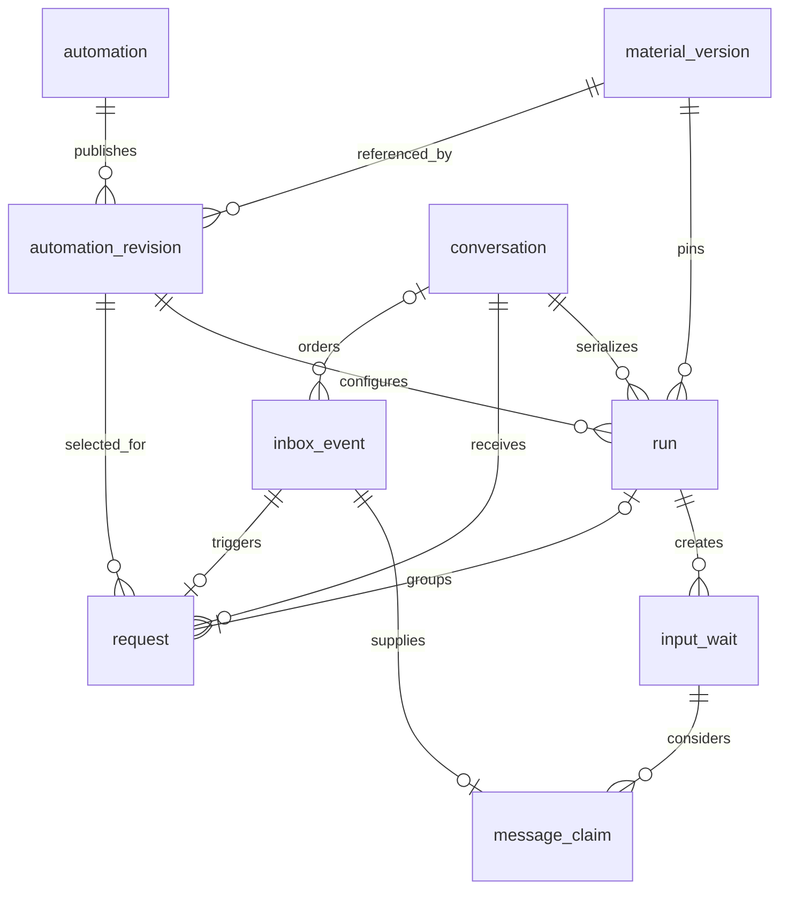
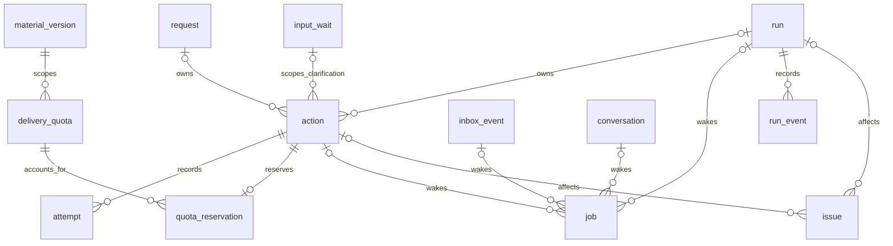

# Data model

This is a logical PostgreSQL model, not a complete migration. The diagrams show the main relationships; the descriptions define ownership, lifecycle, and constraints. Tenant/account tables and identity mapping belong to the existing product and are not reproduced here.

## 1. Configuration is not execution

Scenario code defines the steps, transitions, input validation, and error handling. Customer data selects a supported scenario and supplies its parameters. No record contains a customer-defined graph of executable steps.

| Concept | Meaning | Example |
| --- | --- | --- |
| `automation` | A customer's configured rule with a stable identity | Ask for an email when someone comments `pricing` on this account |
| `automation_revision` | An immutable published set of parameters | Trigger phrases, selected posts, prompt text, link, and timeouts |
| `run` | One durable execution of that rule | The conversation started by comment `C1` |
| `execution_version` | A supported version of the scenario's code/state contract | The handler that understands this run's states |
| `material_version` | A particular version of the resource being offered | Price list V1, distinct from a later price list V2 |

Editing prompt copy creates a configuration revision, not a new scenario algorithm. Publishing a new material version changes the resource and, if quotas are enabled, its accounting scope. An incompatible change to persisted execution states needs an execution-version strategy. These are separate concerns; not every deployment needs a new execution version.

Each accepted run pins its settings. If the owner changes the link while a person is answering, the run does not silently switch materials. Newly created runs pin the current published revision. A repeat request can be matched by that revision yet join an existing run, whose execution settings remain unchanged. Current opt-outs, emergency holds, and platform restrictions are always checked live; pinning settings never freezes permission to send.

An alternative is to copy settings into each run instead of using a revision table. Revisions keep a shared, identifiable publication history without duplicating the whole configuration for every run. They do not introduce a workflow engine.

## 2. Definitions, requests, and input

One matched comment produces a `request`. A new request creates a `run`, or joins an equivalent nonterminal run. A run therefore groups one initial request and possibly later repeats. A rejected request may have no run. Only the initial request occupies a queue position; a merged repeat does not add another slot. One conversation may have many historical or queued runs but only one current owner.

### `automation`

**One row:** one rule created by a customer, independent of its runs and configuration history.

Fields: `id`, `tenant_id`, `account_id`, display name, `enabled`, `priority`, `current_revision_id`, and timestamps. The scenario is selected from supported application code, not uploaded by the customer.

This is the stable reference for editing, disabling, history, and grouping repeated requests. Disabling stops new requests; cancelling existing runs is a separate operation. Account identity and enabled status are checked during admission. Existing runs retain their account and pinned settings.

### `automation_revision`

**One row:** one immutable published configuration of an automation.

Fields: `id`, `automation_id`, revision number, selected posts, trigger phrases, message templates, `material_version_id`, timeouts, clarification limits, `scenario_type`, `matcher_version`, `execution_version`, and publication time. Supported parameters are validated at publication. The application interprets them as data, not a step language.

Use unique `(tenant_id, automation_id, revision_number)`. The current-revision reference must point to a revision of the same automation. Validate prepared settings before publishing, then lock the automation and insert the revision and update this reference atomically. Before its first publication a rule has no current revision and cannot match; a failed edit leaves the previous publication unchanged. Runs and requests retain their selected revision after later edits. Retirement or deletion must not remove configuration still needed by retained runs.

### `material_version`

**One row:** a version of a resource offered to recipients.

Fields: `id`, `tenant_id`, logical material key, version label, title, and delivery URL or storage reference. Revisions refer to this record; runs pin it. It is useful for identifying what was offered even without quotas. Delivery counters and reservations are optional extensions.

Published content references are immutable. Reproducible content requires a versioned URL or controlled storage; an unchanged third-party URL does not prove unchanged content. New versions preserve the history of earlier ones and do not clear recipient restrictions.

### `conversation`

**One row:** the coordination boundary for one account-side conversation with a verified participant.

Fields: `id`, `tenant_id`, `account_id`, `canonical_conversation_key`, `participant_id`, nullable `active_run_id`, next ingress/queue sequence values, a concurrency revision, and current send restrictions or references to them.

Use unique `(tenant_id, account_id, canonical_conversation_key)`. Lock this row to assign ingress order, merge requests, select input, or change the active run. `active_run_id` must belong to this conversation. It denotes ownership, not necessarily a nonterminal business status: a cancelled run can retain it while an old DM remains unresolved.

### `inbox_event`

**One row:** one durably accepted source event, including comment, DM, or delivery-status events.

Fields: `id`, tenant/account scope, source deduplication key, event kind, canonical comment/message ID, verified identities, nullable `conversation_id`, payload or protected reference, `ingress_sequence`, `ingress_mark_at`, platform ordering metadata, and processing status.

Use a unique source key within the scope guaranteed by the integration. Events awaiting identity resolution cannot drive a send. Conversation sequence and deadline mark are assigned under the conversation lock, as specified in the [ingress protocol](EXECUTION.md#deadline-boundary).

An event ID and a message ID are different: one DM may appear in several event envelopes. Event deduplication avoids duplicate ingestion; `message_claim` prevents duplicate input processing. Routing an event successfully does not itself mean its message has satisfied a wait.

### `request`

**One row:** one comment matched to the selected automation, including a legitimate repeat comment.

Fields: `id`, account/conversation scope, `source_event_id`, `canonical_comment_id`, pinned `automation_revision_id` and `material_version_id`, disposition, nullable `run_id`, admission time, and queue position for an initial request. Use unique `(tenant_id, account_id, canonical_comment_id)` under the single-winner matching policy, so another envelope for the same comment cannot create another request. Other overlapping matches are recorded as suppressed diagnostics, not additional executable requests.

A disposition explains whether this request opened a run, merged with one, or was rejected and why. A technical redelivery creates no new request. A new comment can create a request even if it joins an existing run; that preserves the person's repeated interest without repeating the DM sequence. A merged request retains the revision that matched its comment for audit, but execution continues with the existing run's pinned revision. Merging requires the same automation and material version. Request-owned acknowledgments and expiry notices use this identity.

### `run`

**One row:** one execution of a supported scenario, including time spent queued.

Fields: `id`, `conversation_id`, `automation_id`, `primary_request_id`, pinned configuration/material/execution versions, business state, revision, total deadline, accepted email or protected reference, and terminal reason/timestamps.

Each run has exactly one initial request; its `primary_request_id` is unique and must refer to a request assigned to this run. Later requests may join the run but do not replace its settings or queue position. References to automation, revision, and material must agree.

A partial unique index prevents two nonterminal runs for `(tenant_id, conversation_id, automation_id, material_version_id)`. Check all such runs, not only `conversation.active_run_id`, before creating one. State updates and continuation jobs commit together. A terminal state does not by itself authorize releasing conversation ownership.

### `input_wait`

**One row:** one durable input expectation within a run, not a blocked process or open network request.

Fields: `id`, `run_id`, input purpose, generation, state (`arming`, `active`, `closed`), candidate-start boundary, response deadline, scan cursor, invalid-response count, and nullable accepted-message reference.

Use unique `(tenant_id, run_id, purpose, generation)`, with at most one open wait for that purpose. Create it before the prompt send and activate after confirmed acceptance. Clarification retries do not create unrelated waits or move the original candidate boundary. Generation checks reject obsolete timer jobs.

### `message_claim`

**One row:** the assignment and processing outcome of a canonical inbound message for a wait.

Fields: `id`, tenant/account scope, `canonical_message_id`, representative `inbox_event_id`, `input_wait_id`, disposition such as accepted or invalid, and processing time.

Use unique `(tenant_id, account_id, canonical_message_id)`. Claim invalid replies too: another envelope for the same message must not increment counters or schedule another clarification. Claim creation, validation outcome, wait updates, and any next action commit together. Only an accepted claim supplies the run's email. The event, wait, and run must resolve to the same conversation.

## 3. Effects, work, and diagnostics

An action has exactly one owner: a run **or** a request. A job has one typed target chosen for its kind, not four simultaneous targets. An issue may be account-scoped without a run/action link. These alternatives require checks and foreign keys; optional diagram edges alone do not express those constraints. Quota entities are needed only when the extension is enabled.

### `action`

**One row:** one intended external effect, such as a public reply, email prompt, clarification, link DM, or request notice.

Fields: `id`, exactly one owner reference (`run_id` or `request_id`), purpose, ordinal, immutable recipient/route and rendered content, state, deadline, next-attempt time, claim token, and nullable platform message ID. Clarification actions are run-owned and also carry `input_wait_id` and `wait_generation`; the referenced wait must belong to that run. The sender checks this context before starting a call, and accepting an email atomically cancels unstarted clarifications.

Use an ownership check and separate unique indexes for `(tenant_id, run_id, purpose, ordinal)` and `(tenant_id, request_id, purpose, ordinal)` over the corresponding non-null owner. Do not rely on uniqueness across nullable owners. Request-level `terminal_notice` uses a fixed ordinal, producing at most one notice per request.

The action ID is the stable idempotency identity. Rendering happens once; editing configuration cannot change a retried send's body. An action may have many attempts, but only one current authorized attempt. `unknown` retains the unresolved external outcome rather than representing an unsent message.

### `attempt`

**One row:** one authorized attempt to execute an action.

Fields: `id`, `action_id`, attempt number, claim/fencing token, start/end times, outcome category, integration request/message IDs, and protected evidence reference. Use unique `(tenant_id, action_id, attempt_number)`.

Create the attempt before the external call. Keep rejected, interrupted, and ambiguous attempts to explain recovery. Late evidence is retained even when its token cannot update the current action state. A lease expiring is not evidence that the external call did not happen.

### `job`

**One row:** a durable wakeup for internal processing, not an outbound effect or a second copy of scenario state.

Fields: `id`, kind, one typed target reference, generation, due time, lease expiry, claim token, and completion time. Targets include an inbox event, conversation, run, or action according to job kind. Enforce permitted target/column combinations with checks and tenant-scoped foreign keys.

Use a unique semantic key `(tenant_id, kind, target, generation)` implemented for the chosen target type. Examples are processing an event, scanning a conversation, firing a wait timer, or waking a send worker. Duplicate/stale jobs recheck authoritative state and become no-ops. Job completion and the transition it caused commit together. A job never replaces the action record for an external send.

### `delivery_quota` (optional)

**One row:** delivery accounting for `(tenant_id, account_id, participant_id, material_version_id)`.

Fields: that unique scope, applicable limit or its authoritative reference, `accepted_count`, and `reserved_count`. Shared material versions share accounting across automations.

Under a row lock, check `accepted_count + reserved_count < limit` and reserve together with creating the link action. If capacity is unavailable, claim the valid input and close its wait but stop the run with `quota_unavailable`, without a link action, reservation, or automatic quota retry. Counters cannot be negative and must reconcile with reservation outcomes. Lowering a limit may leave existing usage above it; do not erase history or silently revoke in-flight reservations.

### `quota_reservation` (optional)

**One row:** the quota entitlement held for one link action.

Fields: `id`, `action_id`, `delivery_quota_id`, state (`reserved`, `accepted`, `released`), timestamps, and a once-only late-failure adjustment marker/evidence reference. Use unique `(tenant_id, action_id)`.

Creation increments reserved usage. Acceptance moves reserved to accepted usage; proven non-send releases reserved usage. Cancellation with no in-flight or unknown attempt is proven non-send: cancel the action, set its reservation to `released`, and decrement reserved usage atomically. An unknown outcome changes neither. Update the reservation, counters, and action result in one transaction. A late delivery-failure adjustment is separate and idempotent, not deletion of the successful attempt history. Verify that the action's recipient and pinned material match the quota scope.

### `issue`

**One row:** a visible operational problem, potentially affecting many runs.

Fields: `id`, tenant/account scope, optional run/action references, cause code, severity, status, first/last occurrence, occurrence count, next recovery step, and resolution metadata.

Group repeated account-wide failures by a stable cause/scope key instead of creating an alert per attempt. A run/action link locates a local problem; account-wide issues need neither. An issue describes what needs attention but is not the authority for resending an action. Recovery rechecks current state and permissions.

### `run_event`

**One row:** an append-only diagnostic entry about a run transition or administrative decision.

Fields: `id`, `run_id`, per-run sequence, time, event type, previous/next state when applicable, optional source/action/attempt references, actor, and sanitized reason. Use unique `(tenant_id, run_id, sequence)`.

Write transition entries with the state change. Record manual recovery decisions and their evidence without placing email addresses, message bodies, or secrets in ordinary history. This is an audit trail, not event sourcing: current run/action/wait records remain authoritative.

## 4. Cross-record rules and access paths

All customer-owned records have an ID, `tenant_id`, and appropriate creation/update timestamps; immutable records do not need mutable update metadata. Composite foreign keys include tenant ownership, and account/conversation consistency must be enforced where references meet. Create mutually linked request/run records in one transaction, using deferred consistency constraints where necessary. Diagram edges omit these repeated columns, not their enforcement. Retention and deletion apply to diagnostic records and references too.

The hot paths need these indexes:

| Access path | Index or constraint |
| --- | --- |
| Admit an event/comment once | Unique integration-scoped event key; canonical-comment request uniqueness |
| Find the next message | Conversation plus ingress sequence; processing/claim lookup |
| Merge repeat requests | Partial nonterminal run uniqueness and lookup by conversation/automation/material |
| Activate the next request | Conversation plus initial-request queue sequence |
| Claim due work | Partial ready-job index by due time; due-action index for retry/reconciliation |
| Find active waits | Run/purpose uniqueness and active deadline lookup |
| Prevent repeated effects/input | Owner/purpose/ordinal action uniqueness; canonical-message claim uniqueness |
| Allocate material quota | Unique quota scope; unique reservation action |
| Diagnose stalled work | Open issue scope, unresolved action state/age, and per-run history sequence |

Keep raw bodies and long history out of polling indexes. Monitor table growth and autovacuum, and clean up in bounded batches. Counters and cached pointers do not override their underlying invariants: reconciliation uses the same locking and transition paths described in [execution details](EXECUTION.md).

These are relational boundaries, not instructions to split the application into services. The first implementation can keep them in one PostgreSQL database and one codebase.
